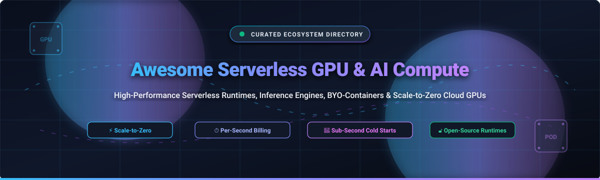
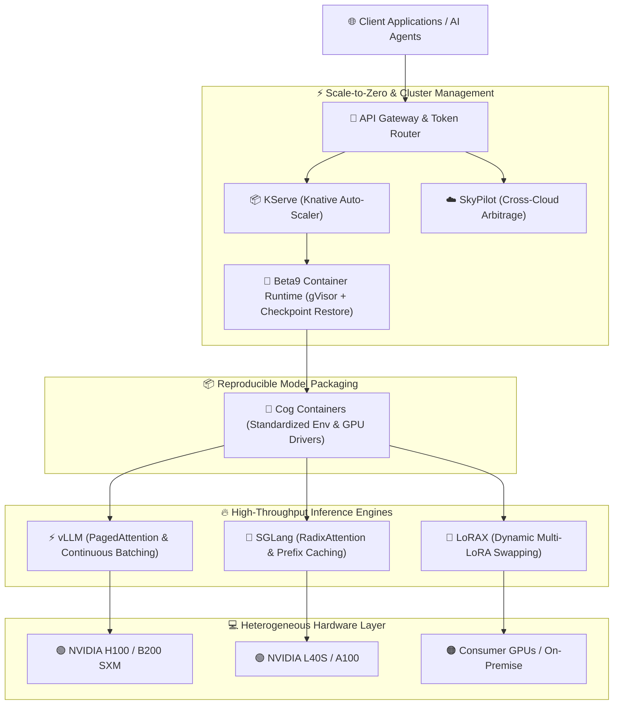

  

# ⚡ Awesome Serverless GPU & AI Compute

> **A curated ecosystem directory of top serverless GPU platforms, high-throughput AI inference runtimes, scale-to-zero container engines, and open-source model serving frameworks.**

---

### 🔍 Quick SEO Keywords & Topics
`Serverless GPU` • `AI Compute` • `Cloud GPUs` • `NVIDIA H100 / B200 / L40S` • `Scale-to-Zero` • `Sub-Second Cold Starts` • `Per-Second GPU Billing` • `vLLM` • `Modal` • `RunPod` • `Together AI` • `Baseten` • `Fireworks AI` • `Groq LPU` • `LLM Serving Runtimes` • `BYO Container AI` • `Distributed GPU Inference` • `Low-Latency AI APIs`

---

## 📑 Table of Contents
- [📊 Sector Overview & Market Dynamics](#-sector-overview--market-dynamics)
- [☁️ Top Hosted & Serverless SaaS Platforms](#️-top-hosted--serverless-saas-platforms)
- [🛠️ Top Open-Source GitHub Projects](#️-top-open-source-github-projects)
- [🏗️ Recommended Architecture Stack for Self-Hosting](#️-recommended-architecture-stack-for-self-hosting)
- [⭐ Star History](#-star-history)
- [💖 Support & Community](#-support--community)
- [🤝 How to Contribute](#-how-to-contribute)
- [📜 Disclaimer & Notes](#-disclaimer--notes)

---

## 📊 Sector Overview & Market Dynamics

The global **AI compute, cloud GPU, and specialized inference infrastructure market** is estimated at **$45B to $60B in 2025/2026**, with projections surpassing **$200B+ by 2030** at an exponential compound annual growth rate (CAGR) of ~36%. The exponential proliferation of frontier open-weight models, reasoning architectures, multimodal generative pipelines, and autonomous AI agents has shifted infrastructure demands away from statically provisioned virtual machines toward dynamic, elastic, per-second metered GPU execution.

From a market concentration standpoint, the sector is **moderately fragmented yet rapidly polarizing**:
- **Hardware & Hyperscaler Layer (Highly Concentrated):** Physical silicon supply and raw cluster capacity remain concentrated among NVIDIA and tier-1 hyperscalers (AWS, Microsoft Azure, Google Cloud).
- **Serverless & Inference Orchestration Layer (Fragmented to Oligopolistic):** The developer layer is fiercely contested. Pure-play serverless innovators (such as Modal, Baseten, Together AI, and Fireworks AI) have outpaced traditional clouds in developer experience by offering custom container runtimes, sub-second cold starts, transparent per-second billing, and true scale-to-zero economics. Rather than a single "winner-take-all" monopoly, the market is solidifying into an **oligopoly of high-efficiency multi-cloud GPU orchestrators** paired with a resilient, self-hostable open-source serving stack.

---

## ☁️ Top Hosted & Serverless SaaS Platforms

The following SaaS platforms enable developers to run production AI inference, fine-tuning, and batch compute without managing Kubernetes clusters or paying for idle GPU capacity.

> **Sorted by Company Scale / Valuation / Revenue (Descending)**

| 🏢 Platform | 📈 Scale & Valuation | ⏱️ Pricing (Starting Tier) | 🎁 Free Tier / Trial Limit | 🚀 Key Capabilities & Workloads |
| :--- | :--- | :--- | :--- | :--- |
| **[Fireworks AI](https://fireworks.ai/)** | **$17.5B Valuation** (Series D) • $1B+ ARR | **$0.00045/sec** (~$1.62/hr) dedicated L40S, or Serverless API from **$0.20 / 1M tokens** (8B) to **$0.90 / 1M tokens** (70B) | **$1.00 one-time API trial credit** upon email signup; Startup accelerator grants up to $10,000 via application | Ultra-fast inference engine processing 40T+ tokens daily. Specialized LoRA fine-tuning and compound AI system hosting. |
| **[Modal](https://modal.com/)** | **$15.75B Valuation** (Series D) • $1B+ ARR | **$0.000164/sec** (~$0.59/hr) for T4, **$0.000222/sec** (~$0.80/hr) for L4, **$0.001097/sec** (~$3.95/hr) for H100 SXM5 | **$30.00/month recurring free credits** every month forever on Hobby plan (resets monthly; no credit card required to start) | Category-defining Python-native serverless platform. Sub-second cold starts, custom container runtimes, sandboxes, and multi-cloud scheduling. |
| **[Baseten](https://www.baseten.co/)** | **$13.0B Valuation** (Series F) • $600M+ ARR | **$0.005/min** (~$0.30/hr) for T4, **$0.019/min** (~$1.14/hr) for A10G, **$0.065/min** (~$3.90/hr) for A100 80GB (billed per GPU-minute) | **$30.00 one-time starter trial credit** upon workspace activation; Baseten for Startups grants up to $25,000 | Enterprise-grade model serving infrastructure powering Cursor and Notion. Dedicated scale-to-zero deployments and Truss container packaging. |
| **[Together AI](https://www.together.ai/)** | **$8.3B Valuation** (Series C) • $1.15B+ ARR | Dedicated GPU endpoints from **$0.00055/sec** (~$1.98/hr); Serverless API from **$0.18 / 1M tokens** (8B) and **$0.88 / 1M tokens** (70B) | **$5.00 one-time starter credit** on account signup; Startup program provides $15,000–$50,000 in promotional compute tiers | Leading open-weight model cloud with 6x–60x cost savings over closed APIs. Optimized inference engine, fine-tuning, and dedicated GPU clusters. |
| **[Groq](https://groq.com/)** | **$3.5B Valuation** (Series E) • $100M+ ARR | **$0.05 / 1M input & $0.08 / 1M output tokens** (Llama 3.1 8B), **$0.59 / 1M in & $0.79 / 1M out** (Llama 3.3 70B) | **Free Developer Tier forever** (no credit card required; rate limits: 30 RPM and 100K–500K tokens/day per model) | Custom LPU (Language Processing Unit) deterministic silicon delivering industry-leading generation speeds (500+ tokens/sec). |
| **[Lambda Cloud](https://lambdalabs.com/)** | **$2.5B Valuation** (Series D) • $250M+ ARR | **$0.50/hr** for 1x A10 (24GB), **$0.60/hr** for 1x RTX 6000 Ada, **$1.29/hr** for 1x A100 (40GB), **$2.49/hr** for 1x H100 SXM5 | **No public free tier**; Academic grants and enterprise evaluation credits ($1,000–$10,000) granted via application | Pioneer in accessible AI infrastructure. High-availability on-demand GPU instances, private AI factories, and multi-node clusters with zero egress fees. |
| **[RunPod](https://www.runpod.io/)** | **$1.0B Valuation** (Series A) • $120M+ ARR | Serverless from **$0.00016/sec** (~$0.58/hr) for RTX A4000, **$0.00019/sec** (~$0.69/hr) for L4, **$0.00116/sec** (~$4.18/hr) for H100 SXM | **No permanent free compute tier** (requires $5.00 minimum prepaid balance); Startup program matches $1,000–$25,000 in credits | Flexible GPU marketplace with Community & Secure Cloud tiers. Serverless endpoints scale to zero; free container pulls and model cache loading. |
| **[Replicate](https://replicate.com/)** | **$350M Valuation** (Cloudflare) • $6M+ ARR | **$0.000025/sec** (~$0.09/hr) CPU, **$0.000225/sec** (~$0.81/hr) T4, **$0.000975/sec** (~$3.51/hr) L40S, **$0.001400/sec** (~$5.04/hr) A100 | **5–10 free test model runs** (~$0.05 value) on web playground upon email verification; API requires funded credit balance | Huge catalog of community models deployable via Cog open container format. Great for multimodal models (image, speech, video generation). |
| **[Cerebrium](https://www.cerebrium.ai/)** | **$30M Valuation** ($9.5M Seed) • Seed Stage | **$0.000164/sec** (~$0.59/hr) for T4, **$0.000583/sec** (~$2.10/hr) for A100 80GB, **$0.000944/sec** (~$3.40/hr) for H100 80GB | **Free forever Hobby Plan ($0/mo platform fee)**: 3 seats, 3 deployed apps, 500 containers, 5 concurrent GPUs, 100 GB storage free | Low-latency serverless platform purpose-built for real-time voice, video, and audio AI pipelines. Cold-start time is strictly unbilled. |
| **[Beam Cloud](https://www.beam.cloud/)** | **$25M Valuation** ($4M Seed) • $1M+ ARR | **$0.000164/sec** (~$0.59/hr) for T4, **$0.000192/sec** (~$0.69/hr) for RTX 4090, **$0.000292/sec** (~$1.05/hr) for A10G | **$30.00/month recurring free credits** on Developer Plan + 1 TB bundled persistent storage + unlimited egress bandwidth | Open-source alternative to Modal powered by the Beta9 runtime. GPU checkpoint restore, gVisor isolation, and multi-node clusters. |

---

## 🛠️ Top Open-Source GitHub Projects

Explore the leading open-source engines, containerizers, schedulers, and serving runtimes for building self-hosted, vendor-neutral serverless GPU systems.

> **Sorted by GitHub_Stars_Count (Descending)**

| 📦 Repository & Link | ⭐ GitHub_Stars_Badge | 📜 License | 🎯 Category & Core Architectural Focus |
| :--- | :--- | :--- | :--- |
| **[ollama/ollama](https://github.com/ollama/ollama)** |  | `MIT` | **Local & Serverless AI Runner** — Get up and running with Llama, Mistral, and deep learning models locally or in containerized serverless pods with a clean REST API. |
| **[ggml-org/llama.cpp](https://github.com/ggml-org/llama.cpp)** |  | `MIT` | **High-Efficiency C/C++ Inference** — Minimal dependency engine supporting GGUF 2-bit to 8-bit integer quantization across consumer GPUs, Apple Silicon, and CUDA clusters. |
| **[vllm-project/vllm](https://github.com/vllm-project/vllm)** |  | `Apache-2.0` | **High-Throughput LLM Engine** — State-of-the-art serving engine featuring PagedAttention, continuous batching, chunked prefill, and speculative decoding. Industry standard. |
| **[mudler/LocalAI](https://github.com/mudler/LocalAI)** |  | `MIT` | **Self-Hosted OpenAI Alternative** — Drop-in OpenAI API replacement for local and edge inference across audio, text, embeddings, and image generation. |
| **[ray-project/ray](https://github.com/ray-project/ray)** |  | `Apache-2.0` | **Distributed Compute & Ray Serve** — Programmable orchestration framework for scaling AI workloads, model pipelines, and dynamic multi-GPU microservices with autoscaling. |
| **[sgl-project/sglang](https://github.com/sgl-project/sglang)** |  | `Apache-2.0` | **High-Performance Serving & RadixAttention** — Fast framework designed for structured outputs, multi-turn dialogues, and automated prompt prefix caching. |
| **[NVIDIA/TensorRT-LLM](https://github.com/NVIDIA/TensorRT-LLM)** |  | `Apache-2.0` | **Hardware-Optimized LLM Runtime** — NVIDIA's compiled inference library leveraging custom kernels, FP8/FP4 precision, and in-flight batching for maximum GPU saturation. |
| **[bentoml/OpenLLM](https://github.com/bentoml/OpenLLM)** |  | `Apache-2.0` | **Production LLM Operations** — High-level abstraction over vLLM and HuggingFace for deploying, fine-tuning, and managing open-source LLMs in cloud-native production. |
| **[triton-inference-server/server](https://github.com/triton-inference-server/server)** |  | `BSD-3-Clause` | **Enterprise Multi-Framework Server** — NVIDIA's production serving tool supporting concurrent execution of ONNX, PyTorch, TensorRT, and custom backend models. |
| **[huggingface/text-generation-inference](https://github.com/huggingface/text-generation-inference)** |  | `Apache-2.0` | **Hugging Face Production Serving (TGI)** — Rust/Python inference server powering Hugging Face Endpoints with tensor parallelism and token streaming. |
| **[skypilot-org/skypilot](https://github.com/skypilot-org/skypilot)** |  | `Apache-2.0` | **Multi-Cloud GPU Orchestrator** — Run LLMs and batch AI jobs on any cloud (AWS, GCP, Azure, Lambda, RunPod) while automatically finding the cheapest GPU instances. |
| **[xorbitsai/inference](https://github.com/xorbitsai/inference)** |  | `Apache-2.0` | **Xinference Distributed Serving** — Distributed model serving library empowering speech, text, vision, and multimodal AI workflows across heterogeneous hardware. |
| **[replicate/cog](https://github.com/replicate/cog)** |  | `Apache-2.0` | **Containers for Machine Learning** — Package ML models into reproducible, production-ready Docker containers with automatic GPU driver detection and HTTP APIs. |
| **[bentoml/BentoML](https://github.com/bentoml/BentoML)** |  | `Apache-2.0` | **Unified AI Application Platform** — Framework for composing, deploying, and serving compound AI architectures, vision models, and multi-model chains. |
| **[kserve/kserve](https://github.com/kserve/kserve)** |  | `Apache-2.0` | **Kubernetes-Native Model Serving** — Standardized serverless inference platform on Kubernetes featuring Knative-powered scale-to-zero, autoscaling, and canary rollouts. |
| **[gpustack/gpustack](https://github.com/gpustack/gpustack)** |  | `Apache-2.0` | **Private GPU Cluster Management** — Lightweight open-source platform to aggregate heterogeneous GPUs (NVIDIA, Apple Silicon, AMD) into an AI compute pool. |
| **[turboderp-org/exllamav2](https://github.com/turboderp-org/exllamav2)** |  | `MIT` | **Fast Quantized GPU Inference** — Extremely fast inference library for EXL2 quantized models tailored for high token throughput on modern consumer and enterprise GPUs. |
| **[predibase/lorax](https://github.com/predibase/lorax)** |  | `Apache-2.0` | **Multi-LoRA Fine-Tune Serving** — Serve thousands of fine-tuned adapter models on a single GPU without cold starts by dynamically swapping LoRA weights at runtime. |
| **[beam-cloud/beta9](https://github.com/beam-cloud/beta9)** |  | `AGPL-3.0` | **Open-Source Serverless GPU Runtime** — Custom Go container runtime behind Beam Cloud. Delivers sub-second cold starts, gVisor sandbox isolation, and GPU checkpoint-restore. |

---

## 🏗️ Recommended Architecture Stack for Self-Hosting

To build a **fully open-source, vendor-neutral serverless GPU platform** on bare metal or private cloud instances, combine the following layers:

---

## ⭐ Star History

---

## 💖 Support & Community

If this curated directory has helped you architect, optimize, or reduce costs across your AI infrastructure, please consider showing your support:

- ⭐ **Star this repository** on GitHub to keep it visible for fellow AI engineers!
- 🍴 **Fork and contribute** new benchmarks, tools, and platforms.
- 📢 **Share with your team** and AI community networks.
- ☕ **Sponsor the Maintainer** — Buy a coffee or support ongoing maintenance on the [GitHub Sponsor Dashboard](https://github.com/sponsors/ishandutta2007).

Your backing fuels ongoing monitoring of pricing models, cold-start benchmarks, and emerging open-source GPU runtimes!

---

## 🤝 How to Contribute

Contributions from the community are warmly welcome!
1. **Fork the repo** to your personal account.
2. **Add or update entries** in `README.md` following the established table formats.
3. **Verify accuracy**: Provide specific starting tier pricing, explicit free tier or trial credit limits, and official documentation links.
4. **Submit a Pull Request** with a descriptive title and rationale.

---

## 📜 Disclaimer & Notes

- This repository is a **community-curated index** created solely for educational and informational purposes; inclusion does not constitute a commercial endorsement.
- Cloud GPU pricing, token rates, and free tier policies fluctuate rapidly; always confirm current terms on provider billing documentation prior to deploying production workloads.
- All trademarks, logos, and brand names are the property of their respective owners.

---

**Built with ❤️ for AI Engineers, ML Platform Teams, and Systems Architects.**  
*Making GPU compute elastic, transparent, and accessible worldwide.*

